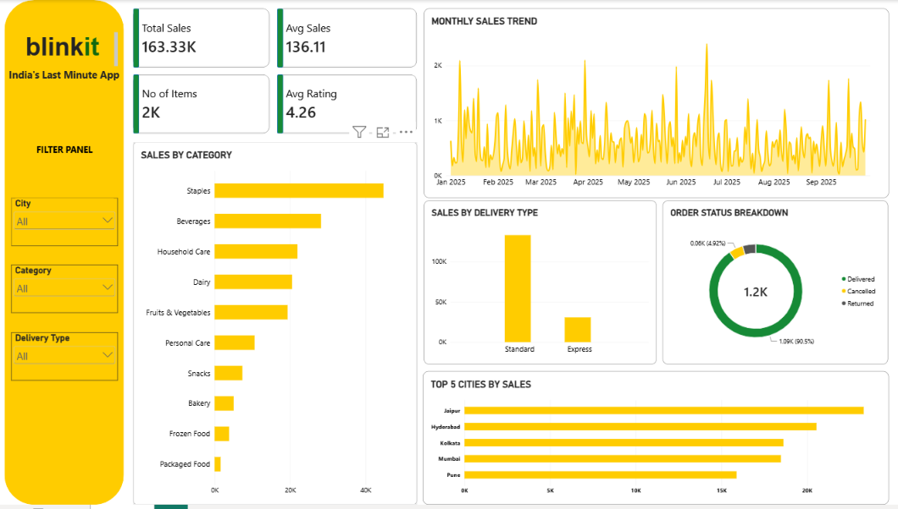

# Blinkit Sales & Delivery Analytics | Power BI

**Turning Sales Data into Actionable Business Insights**

## 📌 Project Overview

This project analyzes Blinkit sales and delivery data using Microsoft Power BI to understand sales performance, product category contributions, delivery methods, order status, and city-wise sales.

An interactive dashboard was developed to transform raw data into meaningful business insights and support data-driven decision-making.

## 🎯 Project Objectives

- Analyze overall sales performance and key business KPIs.
- Identify top-performing product categories.
- Track monthly sales trends throughout 2025.
- Compare sales across delivery types.
- Analyze order status distribution.
- Identify the top 5 cities by sales.
- Build an interactive dashboard using slicers and visualizations.

## 🛠️ Tools & Technologies

- Microsoft Power BI
- Power Query
- DAX
- Data Visualization
- Business Intelligence
- Excel (Raw Dataset)

## 📊 Key Performance Indicators (KPIs)

| KPI | Result |
|---|---:|
| Total Sales | ₹163,332.96 |
| Average Sales | ₹136.11 |
| Total Items Sold | 1,922 |
| Average Customer Rating | 4.26 |

## 🔍 Key Business Insights

1. **Sales Performance:** Total sales reached ₹163.33K, providing an overview of the business's sales performance.
2. **Top Product Category:** Staples recorded the highest sales among the categories displayed in the dashboard.
3. **Delivery Analysis:** Standard delivery contributed more sales than Express delivery.
4. **Order Status:** Delivered orders represented approximately 90.5% of orders in the dashboard.
5. **City-wise Performance:** Jaipur ranked first among the displayed cities, followed by Hyderabad, Kolkata, Mumbai, and Pune.
6. **Customer Ratings:** The average rating of 4.26 indicates generally positive customer feedback.

## 📈 Dashboard Features

- Interactive KPI cards
- Monthly Sales Trend
- Sales by Category
- Sales by Delivery Type
- Order Status Breakdown
- Top 5 Cities by Sales
- City, Category, and Delivery Type slicers
- Dynamic filtering and cross-visual interaction

## 📂 Raw Dataset

The project uses the Blinkit sales dataset containing order, product, category, city, delivery, sales, and customer-rating information.

**Dataset file:** `Blinkit_Analytics_Raw_Data.xlsx`

[📥 Download Raw Dataset](./Blinkit_Analytics_Raw_Data.xlsx)

## 📷 Dashboard Preview

## 💡 Skills Demonstrated

- Data Analysis
- Dashboard Development
- Data Visualization
- KPI Reporting
- Business Insight Generation
- Interactive Reporting
- Power BI and DAX

## 🚀 Conclusion

This project demonstrates how raw retail sales data can be transformed into an interactive business intelligence dashboard. It helps identify sales patterns, understand category and delivery performance, and compare city-level results through clear visualizations.

---

**Developed by Rahul Raigar**  
Aspiring Data Analyst | Power BI | SQL | Python

**GitHub:** [View My Projects](https://github.com/RAHULRAIGAR)

